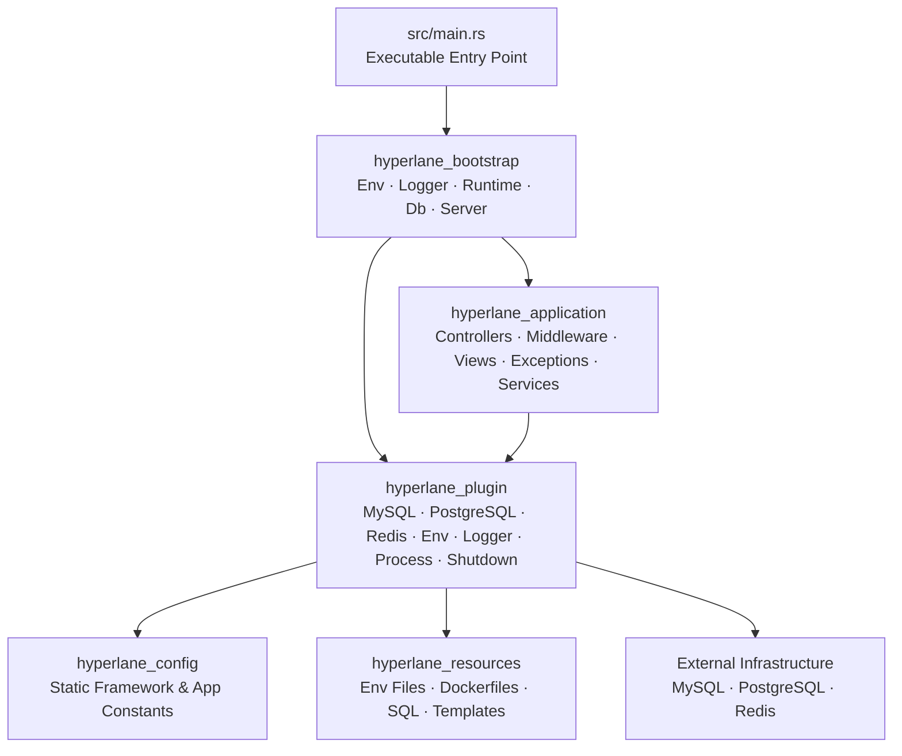

<div align="center">


# hyperlane-quick-start

**Production-Ready Layered Rust 2024 Service Template for Hyperlane, SeaORM, Redis & Static musl Delivery**

[](https://crates.io/crates/hyperlane-quick-start)
[](https://docs.rs/hyperlane/latest/hyperlane/)
[](https://github.com/hyperlane-dev/hyperlane-quick-start/actions/workflows/rust.yml)
[](https://www.rust-lang.org)
[](./LICENSE)

[Overview](#overview) · [Architecture](#architecture) · [Workspace Matrix](#workspace-matrix) · [Quick Start](#quick-start) · [Configuration](#configuration--operations) · [Verification](#verification--governance) · [Agent Governance](./AGENTS.md)

</div>

---

## Overview

**hyperlane-quick-start** is the official production starter template and layered reference architecture for the [`hyperlane`](https://github.com/hyperlane-dev/hyperlane) web framework. It organizes a full-stack Rust 2024 backend into **5** strictly bounded workspace crates—covering configuration, environment/Docker/SQL resources, MySQL/PostgreSQL/Redis infrastructure plugins, HTTP application layers, and a unified composition root—ready to deploy via one-command Docker Compose or a zero-libc static `x86_64-unknown-linux-musl` binary.

---

## Architecture



### Startup & Request Lifecycle

1. **Boot Sequence (`src/main.rs`)**: `EnvBootstrap::init()` -> `LoggerBootstrap::init()` -> `RuntimeBootstrap::init()` -> `DbBootstrap::init().await` (connects MySQL, PostgreSQL, Redis and runs topological schema auto-creation) -> `ProcessPlugin::create(...)` -> `ServerBootstrap::init().await`.
2. **Server Composition (`hyperlane_bootstrap`)**: `ServerBootstrap` applies `ServerConfig` and `RequestConfig` loaded from environment settings, binds `hyperlane_application` hooks via `#[hyperlane(server: Server)]` and `#[import(hyperlane_application)]`, logs every static/dynamic/regex route, and registers `ShutdownPlugin` before awaiting the server control handle.
3. **Middleware & Error Hooks (`hyperlane_application`)**: Request pipeline (`HttpRequestMiddleware`, `CrossMiddleware`, `ResponseHeaderMiddleware`, `ResponseStatusCodeMiddleware`), response pipeline (`SendMiddleware`, `LogMiddleware`), exception handlers (`TaskPanicHook`, `RequestErrorHook`), and views (`FaviconRoute`).

---

## Workspace Matrix

All crates share a unified version in root [`Cargo.toml`](./Cargo.toml) (Rust edition `2024`, resolver `3`):

| Crate                                              | Path           | crates.io                                                                                                              | docs.rs                                                                                                                    | Responsibility                                                                                              |
| :------------------------------------------------- | :------------- | :--------------------------------------------------------------------------------------------------------------------- | :------------------------------------------------------------------------------------------------------------------------- | :---------------------------------------------------------------------------------------------------------- |
| `hyperlane-quick-start`                            | `.` (`src/`)   | [](https://crates.io/crates/hyperlane-quick-start) | N/A (binary)                                                                                                               | Executable entry point wiring bootstrap, process PID lifecycle, and Tokio runtime                           |
| [`hyperlane_resources`](./resources/README.md)     | `resources/`   | [](https://crates.io/crates/hyperlane_resources)     | [](https://docs.rs/hyperlane_resources)     | Dev/release `.env` templates, Dockerfiles, Compose files, SQL scripts, and HTML/static asset paths          |
| [`hyperlane_config`](./config/README.md)           | `config/`      | [](https://crates.io/crates/hyperlane_config)           | [](https://docs.rs/hyperlane_config)           | Static application and framework constants (logger defaults, logo URL, server defaults)                     |
| [`hyperlane_plugin`](./plugin/README.md)           | `plugin/`      | [](https://crates.io/crates/hyperlane_plugin)           | [](https://docs.rs/hyperlane_plugin)           | Infrastructure plugins (`database`, `env`, `logger`, `mysql`, `postgresql`, `process`, `redis`, `shutdown`) |
| [`hyperlane_application`](./application/README.md) | `application/` | [](https://crates.io/crates/hyperlane_application) | [](https://docs.rs/hyperlane_application) | Business layers: controllers, services, repositories, mappers, models, middleware, views, exceptions        |
| [`hyperlane_bootstrap`](./bootstrap/README.md)     | `bootstrap/`   | [](https://crates.io/crates/hyperlane_bootstrap)     | [](https://docs.rs/hyperlane_bootstrap)     | Composition root initializing env, logger, runtime, databases, and the Hyperlane HTTP server                |

---

## Quick Start

### 1. One-Command Docker Compose

```sh
git clone https://github.com/hyperlane-dev/hyperlane-quick-start.git
cd hyperlane-quick-start
docker compose up -d
```

Open `http://127.0.0.1:65002`.

Root [`compose.yaml`](./compose.yaml) builds the multi-stage release image (`resources/docker/release/server.dockerfile`), starts MySQL, PostgreSQL, and Redis, waits for all three health checks to report healthy, and launches the server using `resources/env/release/server.env`.

A healthy startup logs:

```text
[AUTO-CREATION] Initialization complete MySQL (mysql_default) verified,
PostgreSQL (postgres_default) verified, Redis (redis_default) verified
Server listen in 0.0.0.0:65002
```

### 2. Pull a Published Container Image

To skip the first-run Rust compilation (the release profile disables LTO and is verified in CI inside a 2-CPU / 4 GiB no-swap Alpine container), pull the prebuilt image:

| Branch       | Published Image                                                                 |
| :----------- | :------------------------------------------------------------------------------ |
| `master`     | `hkccr.ccs.tencentyun.com/hyperlane-dev/hyperlane-quick-start:1.0.0`            |
| `playground` | `hkccr.ccs.tencentyun.com/hyperlane-dev/hyperlane-quick-start-playground:1.0.0` |

```sh
docker compose pull
docker compose up -d
```

The image uses a two-stage Alpine build (`rust:1.99-alpine` -> `alpine:3.22` + `ca-certificates`), shipping only the static musl executable and `resources/` with no compiler or `target/` artifacts.

### 3. Run the Static Linux musl Binary Directly

Every GitHub Release ships a statically linked `x86_64-unknown-linux-musl` binary that runs on any Linux distribution without shared libraries:

```sh
curl -fL -o hyperlane-quick-start \
  https://github.com/hyperlane-dev/hyperlane-quick-start/releases/latest/download/hyperlane-quick-start-<version>-linux-x86_64
chmod +x hyperlane-quick-start
./hyperlane-quick-start
```

Keep `./resources/env` and `./resources/static` alongside the binary (e.g., from a clone of this repository).

### 4. Build & Run Locally with Cargo

```sh
cargo build --release
cargo test --workspace --all-features
```

Set explicit parallelism with `cargo build --release -j <N>` on memory-constrained hosts.

---

## Configuration & Operations

### Environment Profiles

- **Development (`cargo run`)**: Reads [`resources/env/dev/server.env`](./resources/env/dev/server.env) (`SERVER_PORT=80`, logs in `./data/dev/logs`, PID in `./data/dev/process/hyperlane.pid`).
- **Release (`cargo run --release` / Docker)**: Reads [`resources/env/release/server.env`](./resources/env/release/server.env) (`SERVER_PORT=65002`, logs in `./data/release/logs`, PID in `./data/release/process/hyperlane.pid`).

Key settings include `SERVER_HOST`, `SERVER_PORT`, `SERVER_BUFFER`, `SERVER_NODELAY`, `SERVER_TTI`, `SERVER_REQUEST_HTTP_READ_TIMEOUT_MS`, `SERVER_REQUEST_MAX_BODY_SIZE`, `MYSQL`, `POSTGRESQL`, `REDIS`, `DB_CONNECTION_TIMEOUT_MILLIS`, and `DB_RETRY_INTERVAL_MILLIS`.

### Operational Commands

```sh
docker compose ps
docker compose logs -f server
docker compose down            # stop and preserve database volumes
docker compose down -v         # stop and remove database volumes
```

MySQL, PostgreSQL, and Redis are exposed only inside the private Compose network to avoid host port conflicts. Inspect them directly with `docker compose exec`:

```sh
docker compose exec postgresql psql -U hyperlane -d hyperlane
docker compose exec mysql mysql -uhyperlane -phyperlane hyperlane
docker compose exec redis redis-cli -a hyperlane ping
```

Pass `-T` when invoking `docker compose exec` non-interactively in scripts.

---

## Verification & Governance

Before committing or pushing, run the full local verification suite matching [`.github/workflows/rust.yml`](./.github/workflows/rust.yml):

```sh
crate fmt
crate fmt --check
cargo fmt --all -- --check
cargo clippy --workspace --all-features --all-targets -- -D warnings
cargo test --workspace --all-features
cargo check --release --workspace --all-features
docker compose config -q
```

- Layered boundaries, engineering rules, Docker/musl invariants, and release governance live in [`AGENTS.md`](./AGENTS.md).
- Project-specific agent workflows live in [`.agents/skills/hyperlane-quick-start/SKILL.md`](./.agents/skills/hyperlane-quick-start/SKILL.md).
- Framework API reference: [`docs.rs/hyperlane`](https://docs.rs/hyperlane/latest/hyperlane/).

## License

This project is licensed under the MIT License. See the [LICENSE](./LICENSE) file for details.

## Contributing

Contributions are welcome! Follow the standards in [`AGENTS.md`](./AGENTS.md) and open an issue or pull request.

## Contact

For inquiries, please contact the author at [root@devhub.vip](mailto:root@devhub.vip).
